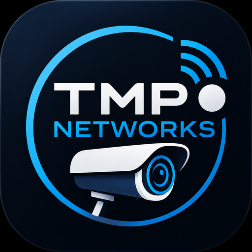

<p align="center">
  
</p>

<h1 align="center">TMP Camera Surveillance Next</h1>

<p align="center">
  <strong>Professionelle Videoüberwachung. Lokal betrieben. Zentral verwaltet.</strong>
</p>

<p align="center">
  Kameraerkennung, Liveansicht, Aufnahmen und Systemverwaltung in einer gemeinsamen Weboberfläche.
</p>

<p align="center">
  <a href="#schnellstart">Schnellstart</a> ·
  <a href="docs/INSTALLATION_DE.md">Installation</a> ·
  <a href="#funktionen">Funktionen</a> ·
  <a href="#aktualisierungen">Aktualisierungen</a> ·
  <a href="CHANGELOG.md">Versionshistorie</a>
</p>

---

## Überblick

**TMP Camera Surveillance Next** ist eine selbst gehostete Kamera- und Aufzeichnungsplattform für Docker-Umgebungen. Die Anwendung vereint die Verwaltung von ONVIF-Kameras und direkten Netzwerkstreams mit einer responsiven Weboberfläche, einem zentralen Medienbroker sowie Funktionen für Livebild, PTZ, Aufnahmen, Ereignisse, Benutzer und Updates.

Die Software kann innerhalb des eigenen Netzwerks betrieben werden. Für den optionalen HTTPS-Fernzugriff steht eine **separat installierte private Cloud-WebApp** zur Verfügung. Die private PHP-Portaldatei gehört bewusst **nicht** zum GitHub-Repository.

**Aktuelle Version:** `2.20.112` · **Installationsart:** Docker · **Oberflächensprachen:** 24

## Funktionen

| Bereich | Möglichkeiten |
|---|---|
| **Kameras** | ONVIF-Erkennung, manuelle Einrichtung, Herstellerprofile und direkte Netzwerkstreams |
| **Liveansicht** | Browser-Livebild über lokalen HLS-Ring, Kamerawechsel und optionaler AAC-Ton |
| **Kiosk-Modus** | Konfigurierbare Kameraraster, individuelle Zuordnung und Vollbilddarstellung |
| **Steuerung** | PTZ-Funktionen, Presets und gerätespezifische Funktionen |
| **Aufnahmen** | Dauer-, Zeitplan-, manuelle und ereignisgesteuerte Aufzeichnung, Wiedergabe und Export |
| **Speicher** | Lokale Aufnahmeblöcke sowie optionale Archivierung über SMB/CIFS oder SFTP |
| **Ereignisse** | Bewegungserkennung, Benachrichtigungen, SMTP und optionale KI-Auswertung |
| **Administration** | Benutzerrollen, Systemstatus, Protokolle, Diagnosen und Update-Center |
| **Clients** | Responsive Browseroberfläche und separater Linux-Desktop-Client |
| **Sprachen** | 24 Oberflächensprachen einschließlich Arabisch mit Rechts-nach-links-Darstellung |

Die verfügbaren Funktionen hängen vom Kameramodell, der Firmware und den angebotenen ONVIF-/Medienprofilen ab.

## Schnellstart

### Voraussetzungen

- Docker-fähiger Linux-Server, unterstütztes NAS oder Docker Desktop auf macOS/Windows mit WSL2
- Docker Engine und Docker Compose (auf unterstützten Linux-Distributionen kann der Erststart fehlendes Docker installieren)
- Netzwerkzugriff vom Kameraserver zu den ONVIF-/RTSP-Adressen der Kameras
- Ausreichend Speicherplatz für System, Docker-Images, Update-Sicherungen und Aufnahmen

**Speicherempfehlung:** Für Betriebssystem, Docker und Updates sind **etwa 40 GB oder mehr als Planungsgröße** sinnvoll; Aufnahmen benötigen zusätzlichen Speicher. Vor umfangreichen Updates sollten möglichst **6–8 GB frei** sein. Dies sind Planungswerte, keine garantierten Mindestanforderungen.

### Installation unter Linux

1. Das Repository über **Code → Download ZIP** herunterladen und vollständig in einen dauerhaften lokalen Ordner entpacken.
2. Im Terminal in den Ordner wechseln, in dem `start.sh` und `docker-compose.yml` liegen.
3. Die Anwendung starten:

```bash
chmod +x start.sh stop.sh update.sh logs.sh scripts/*.sh
./start.sh
```

Wenn der Docker-Zugriff Administratorrechte erfordert:

```bash
sudo ./start.sh
```

Beim ersten Start erzeugt das Skript eine geschützte `.env`, legt persistente Datenordner an, baut die Docker-Images und startet die Dienste.

**Weboberfläche:** `http://SERVER-IP:8080`

**Erstanmeldung:** Benutzer `admin`. Das automatisch erzeugte Kennwort wird beim ersten Start angezeigt und in `.env` abgelegt. Diese Datei enthält vertrauliche Schlüssel und darf nicht veröffentlicht werden.

Die vollständige Anleitung steht in der **[deutschen Installationsdokumentation](docs/INSTALLATION_DE.md)**. Eine [englische Installationsanleitung](INSTALLATION.md) ist ebenfalls verfügbar.

## Kameraeinrichtung und Livebild

1. Unter **Systemstatus** die laufenden Dienste kontrollieren.
2. Über **Kamera hinzufügen** einen ONVIF-Scan starten oder die Kamera-IP manuell angeben.
3. Kamera-Zugangsdaten sowie Main-/Substream prüfen und das Profil speichern.
4. **Liveansicht** öffnen und bei unterstützten Kameras PTZ oder den Kiosk-Modus konfigurieren.
5. Aufnahmespeicher unter **Aufnahmen → Speicher** einrichten und die Verbindung testen.

Bestimmte Kameras benötigen einen manuell angegebenen ONVIF-Port, etwa `8000` bei einigen Reolink-Modellen.

**Live-Ton:** Die normale Vorschau startet stumm. Bei Kameras mit geeigneter Audioquelle kann der Ton bewusst über die Lautsprechertaste aktiviert werden. Der AAC-Audiopfad ist vom sichtbaren Liveplayer getrennt. Browser können zur Tonfreigabe eine Nutzeraktion verlangen; fehlt eine Tonspur, läuft das Video weiter.

## Architektur

| Dienst | Aufgabe |
|---|---|
| `frontend` | Weboberfläche und geschützte Browser-Medienzugriffe |
| `backend` | Kameras, Benutzer, Streaming-Sitzungen, Aufnahmen und APIs |
| `mediamtx` | go2rtc-/FFmpeg-Medienbroker und Codec-Normalisierung |
| `updater` | Prüfung, Sicherung, Installation und Rollback von Updates |

Anwendungsdaten liegen im persistenten Verzeichnis `data/`, Konfiguration und Geheimnisse in `.env`. **Beides darf bei Updates nicht gelöscht oder öffentlich geteilt werden.**

Für geeignete Intel-Systeme steht optional Intel VAAPI nach erfolgreichem Hardwaretest zur Verfügung. Ein Betrieb ohne passende GPU ist möglich.

## Aufnahmen und Speicherung

Standardmäßig liegen Aufnahmen unter `data/recordings/` und die lokale SQLite-Datenbank unter `data/kamera_server.db`. Optional lassen sich abgeschlossene Aufnahmeblöcke in ein SMB-/CIFS- oder SFTP-Archiv übertragen. Laufende Aufnahmen bleiben bis zur Fertigstellung lokal.

Speicherzustand prüfen, **ohne Aufnahmen zu löschen**:

```bash
sudo sh ./scripts/recording-storage-audit.sh
```

Mehr Informationen: [Aufnahmen und Netzwerkspeicher](docs/INSTALLATION_DE.md#5-aufnahmen-und-netzwerkspeicher).

## Aktualisierungen

Das integrierte **Update-Center** führt durch den Ablauf:

**Auf GitHub prüfen → Herunterladen & prüfen → Installieren**

Der Updater prüft Release-Manifest und SHA-256-Prüfsummen, erstellt einen Wiederherstellungspunkt und kann bei Fehlern zurückrollen.

- `.env`, `data/`, Kameradaten und Aufnahmen unbedingt erhalten.
- Genügend freien Platz auf dem Docker-Dateisystem bereitstellen.
- Automatische Update-Sicherungen unter `data/backups` und `data/updates/backups` werden ab 2.20.108 auf die zwei neuesten verifizierbaren Stände begrenzt. Ein benötigter Rollback-Stand bleibt zusätzlich geschützt. Manuelle TAR-Sicherungen und Aufnahmen werden nicht gelöscht.
- Direktupdates ab **2.20.32** folgen den dokumentierten Kompatibilitätsregeln; ältere Versionen benötigen gegebenenfalls einen geprüften Zwischenschritt.
- Kein unkontrolliertes `git pull` über eine laufende Installation ausführen.

Alle Änderungen und früheren Versionsstände sind zentral in der **[Versionshistorie](CHANGELOG.md)** dokumentiert.

## Optionaler HTTPS-Fernzugriff

Ein privat verwalteter Plesk-HTTPS-Zugang ermöglicht die mobile Nutzung über die eindeutige Installations-ID. Die Anmeldung verwendet die normalen Kamera-Server-Zugangsdaten und den ausgehenden Cloud-Agenten. Öffentliche RTSP-Portfreigaben sind dafür nicht erforderlich.

Die **private PHP-WebApp (3.1.2)** wird unabhängig vom Docker-Kameraserver installiert und aktualisiert. Ihr Quellcode, Datenbankzugänge, Geräteschlüssel und andere Geheimnisse werden **nicht in GitHub veröffentlicht**.

## Sprachen und Übersetzungen

Die Weboberfläche unterstützt **24 Sprachen**. Die Auswahl wird im Browser gespeichert; Arabisch aktiviert die Rechts-nach-links-Darstellung. Regionale chinesische Varianten werden korrekt zugeordnet.

Automatische Tests prüfen Schlüssel, Platzhalter und Sprachzuordnung. Die ausführlichen rechtlichen Detailtexte stehen derzeit nur auf Deutsch und Englisch zur Verfügung; in anderen Sprachen weist die Oberfläche ausdrücklich darauf hin.

[Sprachübersicht und Qualitätssicherung](docs/TRANSLATIONS.md)

## Betrieb und Diagnose

Befehle im Projektverzeichnis ausführen:

```bash
# Containerstatus
sudo sh ./scripts/docker-compose.sh ps

# Diagnosebericht
sudo sh ./scripts/diagnose.sh

# Backend- und Medienprotokolle
sudo sh ./scripts/docker-compose.sh logs --tail=150 backend mediamtx

# Docker- und Update-Backup-Speicher
sudo docker system df
sudo du -sh /var/lib/docker /var/lib/containerd data/backups 2>/dev/null
```

Bei wenig freiem Platz zuerst die Speichernutzung prüfen. Kameraaufnahmen und für Rollbacks benötigte Sicherungen niemals pauschal löschen.

## Dokumentation

| Dokument | Inhalt |
|---|---|
| [Deutsche Installationsanleitung](docs/INSTALLATION_DE.md) | Erststart, NAS, Kameras, Cloud, Wartung und Fehlersuche |
| [Englische Installationsanleitung](INSTALLATION.md) | Ausführliche Anleitung in englischer Sprache |
| [Update-Kompatibilität](docs/UPGRADE_COMPATIBILITY.md) | Direktupdates und Legacy-Sicherheitsprüfungen |
| [Plattform-Kompatibilität](docs/COMPATIBILITY.md) | Betriebssysteme, Browser und Medienprotokolle |
| [Netzwerkstreams](docs/NETWORK_STREAMS.md) | Zusätzliche Videoquellen und deren Einrichtung |
| [Übersetzungen](docs/TRANSLATIONS.md) | Sprachkatalog, Fallbacks und Prüfverfahren |
| [Datenschutz](docs/PRIVACY_AND_DATA_PROCESSING.md) | Datenschutz und Betreiberverantwortung |
| [Drittanbieter-Hinweise](docs/THIRD_PARTY_NOTICES.md) | Komponenten und Lizenzen |
| [Versionshistorie](CHANGELOG.md) | Zusammengefasste Änderungen aller Versionen |

## Lizenz und Hersteller

Die Nutzung unterliegt den mit der Software bereitgestellten **[Lizenzbedingungen](LICENSE_AGREEMENT.md)**. Drittanbieter-Komponenten behalten ihre jeweiligen Lizenzbedingungen. Hersteller- und Produktnamen dienen nur der technischen Beschreibung und bedeuten keine Zertifizierung oder Partnerschaft.

**TMP Camera Surveillance Next** · TMP-SYSTEM-SERVICE GmbH


### Behördenexport als MP4 (2.20.105)

Der Behördenexport bleibt ein ZIP-/ZIP64-Download. Die Datei enthält ausschließlich `export.mp4`, `manifest.json` und `README.txt`. Die Original-Aufnahmeblöcke werden serverseitig zu einer MP4 mit durchgehender Medienzeitachse zusammengefügt. Video wird bei kompatiblen Blöcken ohne Neucodierung übernommen; Nicht-AAC-Audio kann in AAC umgewandelt werden. Aufnahmelücken werden im Manifest dokumentiert, nicht mit künstlichem Videomaterial gefüllt. Der erste/letzte Block kann über das gewählte Zeitfenster hinausragen. Bei inkompatiblen Aufnahmeformaten bricht der Export mit einem Hinweis ab, statt eine unvollständige MP4 auszuliefern.

Ein vollständiger Kalendertag (00:00–24:00) ist weiterhin auswählbar. Die Oberfläche wartet auf die fertige MP4 und startet dann den nativen ZIP-Download mit einer einmaligen, rollenbeschränkten Freigabe. Das ZIP wird nicht zusätzlich auf dem Server gespeichert. Für die temporäre MP4 ist ausreichend freier Speicher erforderlich; nach dem Download bzw. Ablauf wird sie entfernt. SHA-256 und CRC32 beziehen sich auf die exportierte MP4. Originalaufnahmen bleiben unverändert.

### Aufnahmeplayer mit durchgehender Zeitachse (2.20.106)

Ein Klick auf die Tagesübersicht öffnet einen Player mit der Zeitachse des gesamten gewählten Kalendertags dieser Kamera. Vorhandene Aufnahmezeiten sind farbig markiert, Lücken bleiben sichtbar. Der Regler, die Pfeiltasten und die Sprungschaltflächen ermöglichen Vor- und Rücksprünge auch innerhalb eines Aufnahmeblocks. Beim Öffnen einer einzelnen Aufnahme steht deren gesamter abgeschlossener Zeitraum zur Verfügung; auch im lokalen mobilen Player. Eine unveränderliche HLS-Wiedergabeliste verbindet die Blöcke ohne erneute Videokodierung. Die MP4-Behördenexporte bleiben unverändert. Ein neuer Playeraufruf aktualisiert die Liste mit inzwischen abgeschlossenen Blöcken.

### Netzwerkarchivierung bei Speicherdruck (ab 2.20.109)

Fertige Aufnahmeblöcke dürfen nach zehn Minuten Wartezeit auf die optionale Hintergrundkomprimierung direkt archiviert werden, solange sie nicht bereits komprimiert werden. Bei knappem lokalem Speicher (standardmäßig unter 2 GiB) oder einem Upload-Rückstau ab 512 MiB erhalten direkte SMB-/SFTP-Übertragungen Priorität. Zwei parallele Upload-Aufträge im Normalbetrieb, bis zu vier bei Speicherdruck; ab 2.20.110 werden SMB-Client-Aufrufe je Server aus Gründen des Kontoschutzes serialisiert. Eine lokale Kopie wird erst nach erfolgreicher Übertragung und Größenprüfung entfernt. Die Parameter sind über `.env.example` dokumentiert. Ein nicht erreichbares Netzwerkziel kann weiterhin lokalen Speicher belegen.

### SMB-Kontoschutz (ab 2.20.110)

Nach einer abgelehnten SMB-Anmeldung (z. B. `NT_STATUS_LOGON_FAILURE`, gesperrtes Konto oder abgelaufenes Kennwort) setzt die Anwendung alle weiteren SMB-Verbindungsversuche zum betreffenden konfigurierten Servernamen bzw. zur IP-Adresse für 60 Minuten aus. Die Sperrfrist wird in der Systemdatenbank gespeichert. Uploads, Abrufe, manuelle Verbindungstests und Löschoperationen nutzen dieselbe Sperre. Das Frontend zeigt unter Aufnahmen → Speicher den frühesten nächsten Versuch an. Aufnahmen werden lokal gepuffert, solange ausreichend Speicher vorhanden ist; bereits archivierte Daten bleiben erhalten. Andere Speicherziele und SFTP sind nicht betroffen. SMB-Client-Aufrufe zum selben Server werden seriell ausgeführt, um parallele Fehlanmeldungen zu verhindern. Unterschiedliche Host-Aliase werden nicht automatisch als derselbe Server erkannt. Nach Ablauf wird automatisch erneut versucht. Bei einer dauerhaften NAS-Sperre oder falschen Zugangsdaten muss das Problem am NAS bzw. in den Speicherprofilen behoben werden.

Ab 2.20.111 wartet jede neue SMB-Sitzung am selben konfigurierten Host standardmäßig mindestens eine Sekunde nach Abschluss der vorherigen Sitzung. Das gilt auch für Protokoll-Fallbacks und diagnostische TCP-Probes, unabhängig vom Upload-Rückstau. Einstellbar über `NETWORK_RECORDING_SMB_SESSION_GAP_MS` (250–10000 ms, Standard 1000). Andere Hosts und SFTP werden dadurch nicht gebremst. Bei sehr kurzen Aufnahmeblöcken oder langsamem NAS kann der lokale Rückstau wachsen; Speicherstatus und freien Platz überwachen. Die 60-minütige Kontoschutzpause nach abgelehnter Anmeldung bleibt bestehen.

### SMB-Bestand und Bereinigung (ab 2.20.112)

Administratoren können unter **Aufnahmen → Speicher → SMB-Bestand und Bereinigung** den tatsächlich vorhandenen Bestand im aktiven Kamera-Zielordner prüfen. Eine manuell gestartete, rekursive SMB-Verzeichnisliste meldet die von der Freigabe sichtbare Gesamtkapazität, freien Platz, logische Dateigrößen, größte Unterordner und den Datenbankabgleich. Es werden keine Video-Inhalte heruntergeladen. Die Abfrage läuft als Backend-Auftrag; Statusabrufe öffnen keine weiteren SMB-Sitzungen. Der Scan ist auf 180 Sekunden, 32 MiB Listenausgabe und 200.000 Einträge begrenzt; unvollständige oder nicht sicher interpretierbare Listen erlauben keine Löschung. Während einer großen Liste wartet die normale SMB-Warteschlange; ausreichend lokalen Puffer vorhalten.

Eine Löschvorschau enthält höchstens 200 mindestens sieben Tage alte Dateien im generierten Format `recording-ID/000001-hash.ts` (bzw. unterstützte Video-Endungen und alte `.uploading-UUID`-Dateien), deren Aufnahme-ID nicht mehr in SQLite existiert, aber unterhalb oder auf dem zuletzt vergebenen ID-Stand liegt, und für die keine Datenbankreferenz existiert. Andere Dateien, bestehende Aufnahme-IDs, neuere IDs und jüngere Dateien bleiben geschützt. Nur nach ausdrücklicher Bestätigung, dass der Ordner ausschließlich dieser Installation gehört und die Vorschau-Dateien entbehrlich sind, werden die gezeigten Dateien gelöscht. Die Vorschau läuft nach 30 Minuten ab; Dateigröße, Änderungszeit, aktuelle Aufnahme-Referenzen und das aktive Speicherprofil werden vor jedem Löschvorgang erneut geprüft. Die SMB-Verbindungspause und Kontoschutzsperre gelten weiterhin. Bei Fehlern stoppt die Bereinigung; sie kann manuell abgebrochen werden. Danach erneut scannen. Kein rekursives Löschen, keine Wildcards beim Löschen und keine Bereinigung anderer Freigaben, NAS-Snapshots oder NAS-Papierkörbe. Die angezeigten logischen Dateigrößen sind nicht mit physisch freigegebenem Speicher gleichzusetzen. DSM-Snapshots, Quotas und Papierkorb können die tatsächliche Platzfreigabe beeinflussen. Gemeinsame Archivordner mehrerer Installationen und kürzlich wiederhergestellte Datenbanken sind nicht zur Bereinigung geeignet.
